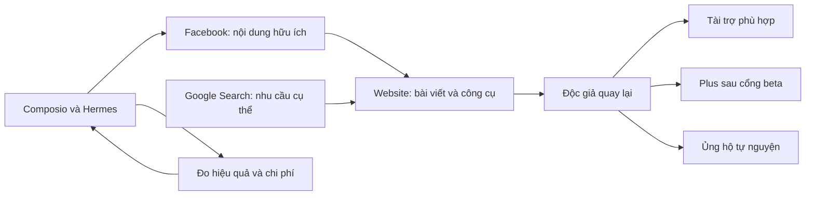

# Chiến lược Composio 90 ngày cho Kim Tuyến — Vàng Hôm Nay

**Ngày lập và đối chiếu bằng chứng:** 04/10/2026, giờ Việt Nam (Asia/Saigon).  
**Dự án:** chart-gold — [www.vanghomnay.online](https://www.vanghomnay.online/).  
**Người thực hiện:** chủ dự án, 10–15 giờ/tuần; lịch mẫu dùng 12 giờ/tuần.  
**Trần thử nghiệm:** tối đa 3.000.000đ chi tăng thêm/tháng, mục tiêu tháng đầu 1.000.000–1.500.000đ.  
**Bàn giao của tài liệu:** chiến lược, quy trình, lịch, mô hình kinh tế và đầu bài triển khai. Các kết nối mới, sự kiện đo lường và gói tài trợ bên dưới là việc đề xuất, chưa được tạo chỉ bởi việc viết tài liệu này.

## Mục lục

1. [Tóm tắt quyết định](#tom-tat)
2. [Hiện trạng và bằng chứng](#hien-trang)
3. [Độc giả, nhu cầu và lời hứa sản phẩm](#doc-gia)
4. [Ma trận nền tảng và thứ tự kết nối](#nen-tang)
5. [Mô hình doanh thu và cách thử](#doanh-thu)
6. [Sáu quy trình Composio](#quy-trinh)
7. [Lịch nội dung mẫu bốn tuần](#lich-noi-dung)
8. [Lộ trình 90 ngày](#lo-trinh)
9. [Ngân sách, lợi nhuận và hòa vốn](#tai-chinh)
10. [KPI và cách đo](#kpi)
11. [Điều kiện dừng, tiếp tục và mở rộng](#quyet-dinh)
12. [Danh sách việc triển khai theo ưu tiên](#cong-viec)
13. [Nguồn tham khảo và mẫu vận hành](#nguon)

<a id="tom-tat"></a>
## 1. Tóm tắt quyết định

**Chiến lược chính:** dùng Facebook để đưa đúng người đọc đến website; giúp họ hiểu chi phí mua/bán, thử công cụ và quay lại; kiểm chứng tiền thu bằng tài trợ nhỏ và Plus. Composio hỗ trợ nghiên cứu, chuẩn bị, phân phối và đo hiệu quả. Lợi thế thương mại đến từ nội dung hữu ích và trải nghiệm đáng tin.



Các quyết định áp dụng trong 90 ngày:

- Nội dung và cộng đồng là trọng tâm; chưa chuyển dự án sang dịch vụ triển khai B2B cho tiệm vàng.
- Website và Facebook là hai nơi xuất bản chính. Telegram hiện phục vụ duyệt nội bộ.
- Một bài chuyên sâu, ba bài Facebook phát triển từ bài gốc và một tổng kết mỗi tuần; tổng kết tái sử dụng nguồn đã kiểm chứng.
- Giữ gói Plus hiện có 99.000đ/30 ngày/20 phân tích hoàn tất. Chỉ bán khi đáp ứng chất lượng, chi phí, thanh toán và trạng thái mở bán.
- Thử gói tài trợ 500.000đ sau khi có bốn tuần dữ liệu thực. Đây là giá thử, chưa phải giá thị trường đã khảo sát.
- Tiền chia sẻ từ Facebook, quảng cáo website, affiliate và các nền tảng khác được tính bằng 0 trong ngân sách cơ sở cho tới khi có quyền kiếm tiền và giao dịch thực.
- Ngân sách là trần chi. Phần chưa sử dụng được giữ lại; số kết nối không phải chỉ tiêu tăng trưởng.
- Đánh giá hiệu quả sau cả tiền công chủ dự án. Dương tiền mặt là một bước kiểm chứng, chưa đủ để kết luận mô hình có lãi.

Trong ngày đầu tiên, ưu tiên lập bảng số liệu nền, kiểm tra luồng xuất bản và chọn một chủ đề có nhu cầu rõ. Hoàn thiện khả năng đo trước khi mở thêm kênh.

<a id="hien-trang"></a>
## 2. Hiện trạng và bằng chứng

### 2.1. Quy ước đọc tài liệu

| Nhãn | Ý nghĩa |
| --- | --- |
| Đã xác minh | Quan sát bằng công cụ, mã nguồn hoặc hồ sơ nghiệm thu; có ngày và phạm vi |
| Nhận định | Kết luận chiến lược từ bằng chứng, có thể thay đổi khi xuất hiện dữ liệu mới |
| Giả thuyết thử nghiệm | Giá, chi phí, lịch, tỷ lệ hoặc mục tiêu đề xuất để thử; chưa phải kết quả kinh doanh |
| Chưa xác minh | Không đủ quyền, số liệu, thời gian hoặc chứng cứ; không được thay bằng 0 |

Các tài liệu chiến lược ngày 05/09/2026 trong repo là lịch sử tham khảo. Mô tả cũ về thiếu billing, đăng nhập chỉ cho admin hoặc sổ vàng chỉ trên thiết bị đã không còn phù hợp với mã nguồn hiện tại. Định hướng AI cho người dùng cá nhân trong tài liệu tháng 9 và tính năng tháng 10 là cơ sở gần hơn.

### 2.2. Những gì đã có

| Tài sản | Bằng chứng và giới hạn | Ý nghĩa cho kế hoạch |
| --- | --- | --- |
| Website | Đã GET trang chủ thành công HTTP 200 trong lượt nghiên cứu 04/10; có bảng giá, biểu đồ, công cụ, sổ vàng, AI và Nhịp vàng | Dẫn nội dung tới công cụ sẵn có, không xây sản phẩm mới chỉ để có lời kêu gọi hành động |
| Facebook | Composio trả kết nối ACTIVE; Page được liệt kê là “Kim Tuyến - Giá Vàng Hôm Nay”, ID 1262243656966414; đọc chi tiết có 7 followers và 7 fans | Xuất phát từ tệp rất nhỏ; không lập dự báo dựa trên lượng người xem lớn |
| Facebook Insights | Lượt đọc 04/10 trả 28 bản ghi ngày: 526 content views, 30 post engagements; mốc kết thúc bản ghi từ 07/09 đến 04/10 lúc 07:00 UTC | Đây là tổng lượt trong các bản ghi trả về, không phải 526 người duy nhất hoặc kỳ ngày Việt Nam được chuẩn hóa |
| Website analytics | Đã có Vercel Analytics và Speed Insights; hồ sơ tối ưu ghi ảnh baseline 43 visitors/tuần | Chỉ dùng làm dấu hiệu quy mô nhỏ. 804 CDN requests/6 giờ trong cùng hồ sơ không dùng chung mẫu số với visitors/tuần |
| SEO | Có sitemap, news sitemap, metadata, canonical, bài công khai và trang so sánh | Cải thiện nội dung và liên kết tới công cụ, tận dụng cấu trúc có sẵn |
| AI và thanh toán | Catalog Plus 99.000đ/30 ngày/20 lượt; có SePay, đơn thanh toán, webhook, quota và đối soát | Tận dụng hạ tầng hiện hành khi beta đạt điều kiện |
| Mở bán Plus | Có cờ SUBSCRIPTIONS_SALES_ENABLED. Tài liệu nội bộ gần nhất ghi giữ tắt; GET quyền sử dụng trên production khi chưa đăng nhập trả 401 | Trạng thái production hiện tại chưa xác minh. Chưa khẳng định đang bán hoặc đã có khách |
| Ủng hộ | Có QR, đối soát và bảng vinh danh theo lựa chọn của người dùng | Nguồn phụ; không mở khóa tính năng và không tính như thuê bao |
| Hermes và Telegram | Hồ sơ nghiệm thu 02/10 ghi xuất bản website/Facebook, đọc lại xác nhận và chạy lại không đăng trùng | Dùng lại luồng xuất bản đã có |
| Độ ổn định biên tập | Hồ sơ 03/10 ghi lỗi nguồn, timeout, quota và xử lý kết quả Composio qua artifact; hồ sơ ảnh 04/10 chưa nghiệm thu một bài ảnh mới xuyên suốt toàn luồng | Có nghiệm thu thành công không đồng nghĩa mọi lần tạo bài đều ổn định. Đo bài thực sự xuất bản và lượt thất bại |
| Dữ liệu kinh tế | Schema có analysisRuns, analysisFeedback, aiUsageEvents, billingAuditEvents, editorialCostLedger | Có thể tổng hợp chi phí và chất lượng từ bảng hiện có |

Nguồn nội bộ: [kế hoạch AI](D:/KinhDoanh/chart-gold/docs/ai-analysis-product-plan.md), [xuất bản hai kênh](D:/KinhDoanh/chart-gold/docs/telegram-dual-publication.md), [tối ưu Vercel](D:/KinhDoanh/chart-gold/docs/vercel-optimization-2026-10-04.md), [ảnh bài viết](D:/KinhDoanh/chart-gold/docs/editorial-content-illustrations-2026-10-04.md), [gói bán](D:/KinhDoanh/chart-gold/lib/billing/plans.ts).

### 2.3. Những gì còn thiếu để quyết định đầu tư

Chưa có dữ liệu xác minh về doanh thu, tái mua Plus, độc giả quay lại theo cohort, chuyển đổi từ bài sang công cụ hoặc hóa đơn hạ tầng đầy đủ. Rà soát nguồn chưa tìm thấy hệ thống UTM xuyên hành trình, GA4, newsletter, affiliate hay AdSense đang triển khai. Đây là các khoảng trống cần kiểm tra hoặc bổ sung, không chứng minh không tồn tại tài khoản bên ngoài repo.

Ảnh Composio đang chọn tab **All**, hiển thị 1.596 ứng dụng. Số này thuộc catalog. Trong phiên công cụ đã kiểm tra, Facebook, GitHub và Google Calendar có kết nối hoạt động; các dịch vụ được tìm kiếm khác có trạng thái không ACTIVE hoặc chỉ được nhìn thấy trong ảnh. Kết luận chỉ áp dụng cho phạm vi MCP hiện tại, không phải bản kiểm kê toàn bộ workspace hay mọi tài khoản của chủ dự án.

<a id="doc-gia"></a>
## 3. Độc giả, nhu cầu và lời hứa sản phẩm

**Lời hứa:** giúp người đọc hiểu số liệu giá vàng, chi phí mua/bán và tình huống của mình để biết cần kiểm tra gì tiếp theo. Lời hứa này phải thể hiện qua công cụ, nguồn và cách giải thích.

| Nhóm ưu tiên | Câu hỏi cần giải quyết | Nội dung phù hợp | Hành động sau khi đọc |
| --- | --- | --- | --- |
| Người chuẩn bị tích sản | Mua loại nào, chênh lệch mua/bán ảnh hưởng bao nhiêu? | Hướng dẫn spread, hòa vốn, quy cách, đơn vị | Thử so sánh hoặc hòa vốn |
| Người đang giữ vàng | Giá mua lại hiện tại nghĩa là lãi/lỗ bao nhiêu? | Đọc chiều mua/bán, phí, nơi thu mua, hồ sơ giao dịch | Nhập thử hoặc lưu vào sổ vàng |
| Người theo dõi thị trường | Tin mới ảnh hưởng gì tới vàng trong nước? | Giải thích dữ kiện có nguồn, giới hạn liên hệ | Đọc tiếp bài, đặt câu hỏi phù hợp cho AI |

Ba trụ cột nội dung: **chi phí thực**, **đọc dữ liệu đúng**, **theo dõi khoản vàng của mình**. Tin nóng chỉ được chọn khi giải thích được một nhu cầu trong ba trụ cột này.

Phỏng vấn ngắn 10 người trong tháng đầu, bằng đối thoại tự nguyện: họ thường xem giá ở đâu; lần gần nhất gặp vướng mắc gì; công cụ nào giúp tiết kiệm thời gian; quyền lợi nào họ có thể trả tiền; lý do họ chưa quay lại. Ghi câu trả lời và hành động quan sát được; ý định trả tiền và tiền thực thu là hai mức bằng chứng khác nhau.

Thử hai kiểu CTA: “Xem ví dụ tính hòa vốn” và “Tự tính với số lượng của bạn”. Giữ cùng chủ đề và công cụ để giảm khác biệt; luân phiên theo bài, ghi rõ mẫu nhỏ chưa cho phép kết luận thống kê. Nội dung đọc công khai không cần ép đăng nhập; đăng nhập xuất hiện khi tác vụ cần lưu dữ liệu hoặc dùng quyền AI.

<a id="nen-tang"></a>
## 4. Ma trận nền tảng và thứ tự kết nối

| Công cụ | Trạng thái 04/10 | Công việc đề xuất | Ưu tiên và điều kiện |
| --- | --- | --- | --- |
| Facebook | ACTIVE; Page đọc được | Phân phối bài, lấy insights và phản hồi | P0, dùng hiện tại |
| Website + Hermes | Bridge đã có | Nội dung gốc, công cụ, công khai nguồn, nhận bản duyệt | P0, duy trì nguồn nội dung duy nhất |
| GitHub | ACTIVE, được kiểm tra lại khi viết file | Theo dõi lỗi và đầu bài đo lường | P0, ghi công việc sau khi chốt nội dung |
| Google Calendar | ACTIVE, được kiểm tra lại khi viết file | Lịch nội dung và phiên đánh giá | P0, lịch công việc; không thay scheduler xuất bản |
| Google Sheets | Không ACTIVE trong lượt kiểm kê trước | Bảng nội dung, báo cáo, kinh tế và đối tác | P0, kết nối trước khi tự động ghi; tạm ghi thủ công nếu chưa kết nối |
| Google Search Console | Không ACTIVE trong lượt kiểm kê trước | Query, landing page, impression, click, index | P1, cần quyền property đúng domain |
| Google Analytics | Không ACTIVE trong lượt kiểm kê trước | Hành trình và retention; kết hợp Vercel thay vì đếm chồng | P1, cần tạo/kiểm tra GA4 và instrument website; kết nối Composio riêng chưa tạo tracking |
| Gmail | Không ACTIVE trong lượt kiểm kê; kiểm tra lại khi viết file vẫn không ACTIVE | Công việc đối tác, bản nháp chăm sóc | P2, chỉ khi có workflow cụ thể |
| Mailchimp, HubSpot | Không ACTIVE trong lượt kiểm kê trước | Email có đăng ký, CRM đối tác | P2, đủ nhu cầu trước khi tăng công cụ |
| YouTube, Instagram, X | Không ACTIVE trong lượt kiểm kê trước | Kênh mở rộng tiềm năng | P2, sau 90 ngày hoặc thay thế kênh hiện tại khi có bằng chứng tốt hơn |
| Telegram công khai | Chưa có bằng chứng kênh độc giả | Nhận bản tin tự nguyện | P2, 20 người thật thể hiện nhu cầu và công ≤1 giờ/tuần |
| Supabase, Airtable, Notion, Slack | Không cần cho luồng lõi hiện tại | Công cụ bổ sung theo nhu cầu | Hoãn; PostgreSQL và bảng theo dõi đủ cho giai đoạn này |
| Composio, Code Interpreter | Ảnh hiển thị Active; chưa kiểm kê đầy đủ tính phí hoặc scope | Điều phối, xử lý dữ liệu khi cần | Không coi biểu tượng Active là bằng chứng mọi tác vụ miễn phí |

Thứ tự bổ sung: Sheets → Search Console → GA4. Khi thiếu quyền kết nối, dùng báo cáo thủ công có cùng định nghĩa chỉ số. Không gọi công cụ của toolkit chưa ACTIVE. Không đọc hoặc ghi dữ liệu cá nhân không cần cho mục tiêu đo.

Facebook toolkit Composio hỗ trợ Pages; không suy diễn rằng kết nối này cho phép tự động đăng vào profile cá nhân hay mọi group. [Tài liệu Facebook toolkit](https://docs.composio.dev/toolkits/facebook)

### 4.1. Nguyên tắc dùng Composio có lợi nhuận

Tác vụ cần nội dung, phân tích và quyết định có thể dùng AI. Tác vụ chỉ cộng số, ghép bảng hoặc đọc metric dùng phép tính trực tiếp. Khám phá tool và schema khi thiết lập; tái sử dụng công cụ đã biết trong workflow ổn định. Batch các lần đọc độc lập, tránh polling tốn công cụ khi dữ liệu chỉ cần một lần/ngày.

Đánh giá từng workflow bằng thời gian tiết kiệm, chi phí, tỷ lệ hoàn thành và giá trị kinh doanh. Workflow không có người sử dụng kết quả hoặc không thay đổi quyết định nên tạm dừng. Thay đổi bảng điều khiển không được tạo thêm hệ thống xuất bản hoặc phê duyệt riêng.

<a id="doanh-thu"></a>
## 5. Mô hình doanh thu và cách thử

### 5.1. Tài trợ nội dung: thử đầu tiên sau đủ số liệu

**Gói thử 500.000đ/đơn**, gồm vị trí tài trợ có nhãn trên một bài website liên quan trong 7 ngày, một bài Facebook được duyệt, một liên kết UTM và báo cáo sau 7 ngày. Vị trí này phải được bổ sung nếu sản phẩm chưa có. Không định giá như một bài nghiên cứu mới hoàn toàn hoặc quyền quảng cáo vô thời hạn.

Đối tác thử: đơn vị bán vàng/trang sức có thông tin hoạt động xác minh được, hoặc dịch vụ phù hợp trực tiếp với nhu cầu độc giả. Chọn tối đa 10 ứng viên; ưu tiên liên quan nội dung và khả năng hợp tác minh bạch. Chưa đưa affiliate sàn giao dịch hoặc sản phẩm đầu tư vào kế hoạch doanh thu khi chưa xác minh điều kiện riêng.

Quy trình: lập danh sách → kiểm tra phù hợp → chuẩn bị hồ sơ → trao đổi khi có quyền gửi → chốt phạm vi và nhãn → xác nhận thanh toán/điều kiện → duyệt nội dung → xuất bản → báo cáo. Báo cáo cho thấy số liệu thực và cửa sổ đo, kể cả khi thấp.

Hồ sơ một trang có: đối tượng độc giả, 4 tuần số liệu, 2 bài mẫu, vị trí tài trợ, thời hạn, giá thử và định nghĩa metric. Với baseline hiện tại, trình bày cả 7 followers; không sử dụng tổng views như số người.

Không để nhà tài trợ sửa bảng giá, nguồn hoặc kết luận biên tập để có lợi cho họ. Không hứa lượt tiếp cận, tỷ lệ nhấp hay doanh số. Đơn bàn giao sai phạm vi cần sửa hoặc xử lý theo thỏa thuận; số lượt xem thấp không tự tạo nghĩa vụ bù khi không có cam kết hiệu suất.

Giới hạn pilot: chi tiền mặt biến đổi dự phòng 100.000đ/đơn, công riêng tối đa 2 giờ/đơn, báo cáo nằm trong công này. Nếu cần nhiều giờ hơn, thu hẹp phạm vi hoặc thử giá mới cho đơn kế tiếp; không tự biến gói 500.000đ thành dịch vụ lớn. Phần đóng góp tiền mặt giả định 400.000đ/đơn; sau 2 giờ công ở 100.000đ/giờ còn 200.000đ trước phân bổ chi cố định và thuế.

Sau 2 đơn hoàn tất, hỏi nhu cầu mua lại; chỉ thử gói tháng với báo giá mới khi có kết quả và định mức công. Không tính gói thử là MRR.

### 5.2. Plus: nguồn thu từ giá trị sử dụng

Giữ **99.000đ/30 ngày/20 phân tích hoàn tất**, tận dụng thanh toán SePay hiện có. Quyền lợi, thời hạn và điều kiện hoàn lượt theo sản phẩm hiện hành. Không quảng bá như dịch vụ AI không giới hạn, tự động gia hạn hay cam kết lợi nhuận đầu tư.

Cổng chất lượng tham chiếu kế hoạch AI nội bộ, chưa được tài liệu này xác nhận là đã đạt:

- Pilot 10–15 người và bộ đánh giá 80 tình huống theo nhu cầu.
- Không có lỗi nghiêm trọng về giá/nguồn bịa, chiều mua–bán, đơn vị hoặc dữ liệu cũ trình bày như mới.
- Điểm trung bình ≥4/5 từng tiêu chí; ≥90% ca đạt, báo riêng theo nhu cầu.
- ≥80% người pilot hoàn thành ba tác vụ cơ bản không cần hỗ trợ trực tiếp.
- ≥80% phản hồi hữu ích trên ít nhất 50 đánh giá hợp lệ; báo mẫu số và tỷ lệ phản hồi.
- Mục tiêu p75: dữ liệu đầu tiên ≤5 giây, phân tích chuẩn ≤25 giây, nghiên cứu ≤45 giây. Đây là mục tiêu đo, chưa phải SLA.

Thêm cổng kinh tế đề xuất: biết chi phí AI thực, mức sử dụng và chi phí phục vụ; quyền lợi đã bán phù hợp ngân sách hiện có; có đối soát, hoàn tiền và người xử lý sự cố. Mức 25.000đ/khách/30 ngày ở mô hình tài chính là giả thuyết chi phí, không phải kết quả đã đo. Chủ dự án bật sales sau khi có hồ sơ đánh giá; tự động hóa marketing không bật cờ này.

Mời người dùng thử sau khi đã hoàn thành tác vụ hữu ích. Trước khi mở bán, thu phản hồi và ý định tham gia beta; không dẫn tới gói không mua được. Đo tỷ lệ mua lần đầu, sử dụng, tái mua và hoàn tiền theo cohort; chưa có dữ liệu tái mua thì chưa suy ra LTV.

### 5.3. Ủng hộ tự nguyện

Đặt lời mời sau trải nghiệm hữu ích hoặc cuối bản tổng kết, tần suất đề xuất tối đa một nội dung/tuần. Giữ lựa chọn ẩn danh và tính tự nguyện của luồng hiện có. Theo dõi tiền đã đối soát, khoản hoàn và chi phí riêng. Không dùng “ủng hộ bằng nhấp quảng cáo”, không tính một khoản ủng hộ như doanh thu thuê bao.

### 5.4. Quảng cáo, tiền nền tảng và affiliate

Facebook Content Monetization được thông báo chính thức tháng 3/2026 là theo lời mời, có trả cho nội dung đủ điều kiện gồm ảnh và chữ. Kiểm tra Professional Dashboard của chính Page; quyền kiếm tiền, qualified views và mức thu phải có dữ liệu tài khoản. Baseline tiền nền tảng của kế hoạch là 0đ cho tới khi xác minh. [Meta: Content Monetization](https://about.fb.com/news/2026/03/creator-fast-track-grow-your-audience-earn-money-on-facebook/)

AdSense đòi hỏi nội dung riêng, đáp ứng chính sách và chủ tài khoản đủ tuổi; mỗi website cần được xét duyệt. Chỉ thử vị trí quảng cáo nhẹ sau khi có dữ liệu traffic, quyền tham gia và cách đo tác động tới sử dụng công cụ. [Điều kiện AdSense](https://support.google.com/adsense/answer/9724?hl=en)

Công thức thử độ nhạy: doanh thu quảng cáo = pageview đủ điều kiện / 1.000 × page RPM đo thực. Ví dụ giả định 10.000 pageview/tháng và RPM 20.000đ chỉ tạo 200.000đ. RPM này không phải báo giá hoặc benchmark Việt Nam. Không mua traffic khi chưa biết giá trị tạo ra trên mỗi người đọc.

Affiliate chỉ được đưa vào mô hình sau khi có chương trình, quyền tham gia, hoa hồng, điều kiện duyệt đơn và thanh toán được xác minh. Một đối tác thử trước; nhãn tài trợ/hoa hồng rõ ràng. Email, video, Telegram payout và kênh khác được đánh giá lại sau 90 ngày; chưa cộng thu nhập tiềm năng vào ngân sách.

<a id="quy-trinh"></a>
## 6. Sáu quy trình Composio

Các mục dưới đây là đặc tả triển khai tiếp theo. Tool slug đã khám phá chỉ dùng khi schema và tài khoản phù hợp; slug cho công cụ khác phải tìm qua COMPOSIO_SEARCH_TOOLS. Chủ dự án duyệt quyết định biên tập và thương mại. Không lưu access token, API key hoặc thông tin sổ vàng cá nhân vào bảng marketing.

### W1 — Nghiên cứu, soạn và xuất bản nội dung

| Trường | Đặc tả |
| --- | --- |
| Đầu vào | Chủ đề, nhu cầu độc giả, nguồn, thời điểm, đơn vị và content_id |
| Đầu ra | Bài website, caption Facebook, ảnh, nguồn, bản duyệt, URL và receipt từng kênh |
| Chủ trì | Chủ dự án; Hermes chuẩn bị và worker thực hiện sau duyệt |
| Công cụ | Composio nghiên cứu hiện có, bridge website, Facebook, Telegram duyệt nội bộ |
| Lịch | Chuẩn bị đầu tuần; xuất bản theo lịch mục 7 và khả năng đạt kiểm chứng |
| Giới hạn | Tối đa 100.000đ chi tiền mặt/tuần cho nghiên cứu và ảnh, đồng thời nằm trong phong bì Composio/AI và hình ảnh tháng; ghi cả lượt thất bại |
| Khi lỗi | Giữ request/checkpoint; dừng nguồn không đủ bằng chứng; không tự phê duyệt; dùng luồng tiếp tục phần chưa hoàn tất |

Giữ package đã duyệt bất biến. Website xuất bản trước, Facebook sau; mỗi kênh phải có read-back. Khi timeout tạo post có kết quả chưa biết, đối soát receipt/ledger trước khi gửi lại. Không đăng trùng vì một lần đọc chưa thấy bài. Sửa nội dung hoặc ảnh phải theo quy trình duyệt lại hiện có. Ba bài Facebook trong tuần tái sử dụng hồ sơ nguồn, không buộc cùng approval của bài gốc.

### W2 — Đọc số liệu Facebook và phản hồi

| Trường | Đặc tả |
| --- | --- |
| Đầu vào | Page ID đã xác minh, post ID, cửa sổ thời gian, content_id |
| Đầu ra | Snapshot metric sau 24 giờ/7 ngày, đường dẫn bài, câu hỏi độc giả theo nhóm |
| Chủ trì | Chủ dự án xem báo cáo; tác vụ đọc có thể tự động |
| Công cụ | FACEBOOK_GET_PAGE_DETAILS, FACEBOOK_GET_PAGE_INSIGHTS; tìm schema post insights khi triển khai; Sheets hoặc bảng thủ công |
| Lịch | Một lần/ngày cho số liệu; tổng hợp thứ Bảy, không polling phút |
| Giới hạn | Tối đa 60 lần gọi đọc/tháng ban đầu, gộp khoảng thời gian khi được hỗ trợ; không gọi LLM chỉ để cộng số |
| Khi lỗi | Thiếu scope hoặc token thì đánh dấu chưa lấy được; giữ snapshot cũ có timestamp; không đổi lỗi thành 0; làm đủ phân trang trong cửa sổ đo |

Lưu tên metric API, đơn vị, kỳ, organic/paid nếu API cung cấp. Không cộng unique reach từng ngày thành số người duy nhất tháng. Không tự trả lời bình luận hoặc gửi tin nhắn chỉ vì workflow được thiết lập; trước hết chuẩn bị nháp và danh sách cần chủ dự án xử lý.

### W3 — Kết hợp tìm kiếm, website và hành vi công cụ

| Trường | Đặc tả |
| --- | --- |
| Đầu vào | Landing page, query GSC, nguồn UTM, sự kiện công cụ, cửa sổ Việt Nam thống nhất |
| Đầu ra | Báo cáo 5 chủ đề/landing page tốt nhất, chủ đề thiếu giá trị và đề xuất tuần sau |
| Chủ trì | Chủ dự án chọn ưu tiên sau khi xem dữ liệu |
| Công cụ | GSC, GA4 khi có quyền; Vercel Analytics và dữ liệu ứng dụng hiện có; Sheets |
| Lịch | Hàng tuần, so sánh kỳ cùng độ dài; ghi độ trễ báo cáo GSC/analytics |
| Giới hạn | Tối đa 12 lần gọi báo cáo/tháng cho mỗi hệ thống ở bước đầu; chỉ nghiên cứu thêm tối đa hai chủ đề được chọn/tuần |
| Khi lỗi | Giữ kỳ chưa đầy đủ và trường thiếu; không ghép số từ hệ thống khác thành một metric; tạm dùng xuất báo cáo thủ công |

Ưu tiên bài có người đọc hoàn thành tác vụ, quay lại hoặc đặt câu hỏi cụ thể. Bài nhiều impressions nhưng ít clicks cần xem intent/tiêu đề; bài có clicks nhưng không dùng công cụ cần xem tính liên quan và CTA. Không tăng số bài chỉ để bù chuyển đổi yếu.

### W4 — Ghi chi phí và kinh tế từng nội dung

| Trường | Đặc tả |
| --- | --- |
| Đầu vào | run_id, content_id, provider, usage, khoản phí, thời gian thao tác và trạng thái xuất bản |
| Đầu ra | Chi phí tiền mặt/bài xuất bản, chi phí lượt thất bại, công giờ/bài, chi phí phục vụ Plus |
| Chủ trì | Chủ dự án đối chiếu hàng tuần và hóa đơn cuối tháng |
| Công cụ | Ledger nội dung/AI hiện có; hóa đơn; Sheets. Không cần kho dữ liệu mới |
| Lịch | Ghi sau lượt chạy; tổng hợp tuần/tháng |
| Giới hạn | Chi tháng đã dùng + cam kết + dự kiến phần còn lại ≤3.000.000đ tăng thêm; cảnh báo ở 70% và 90% trần |
| Khi lỗi | Usage chưa biết ghi chưa xác minh; ước lượng gắn nhãn riêng; không ghi 0, không chạy lại AI chỉ để có số phí |

Tính tổng cả nghiên cứu, biên tập, sửa, kiểm chứng, ảnh và lần thất bại để có một bài công khai. Quota tài khoản hết không được coi chi phí bằng 0. Đối chiếu hóa đơn với ledger, loại trừ khoản trùng và tách chi phí hạ tầng đang có H0.

### W5 — Chuẩn bị và theo dõi thử nghiệm tài trợ

| Trường | Đặc tả |
| --- | --- |
| Đầu vào | Danh sách tối đa 10 đối tác phù hợp, số liệu 4 tuần, phạm vi gói thử |
| Đầu ra | Hồ sơ một trang, bản nháp lời mời, trạng thái đơn, báo cáo bàn giao 7 ngày |
| Chủ trì | Chủ dự án xác minh đối tác, gửi và chốt hợp tác |
| Công cụ | Sheets; Gmail nếu được kết nối và có quyền gửi. Calendar cho phiên trao đổi đã chốt |
| Lịch | Ngày 31–60; theo dõi trong quỹ thương mại 2 giờ/tuần |
| Giới hạn | Công ≤2 giờ/đơn; chi biến đổi dự phòng ≤100.000đ/đơn; không mua CRM cho pilot |
| Khi lỗi | Thiếu đồng ý/phạm vi/nhãn thì giữ bản nháp; đọc số liệu lỗi thì báo chưa có; không tự gửi chào mời hàng loạt |

Trạng thái bảng đối tác: cần xác minh, phù hợp, nháp sẵn, đã liên hệ, đang trao đổi, đã chốt, đã thu tiền, đã bàn giao, đã báo cáo, không tiếp tục. Ghi quyền và thời điểm gửi; việc viết tài liệu hoặc kết nối Gmail không tự cho phép liên hệ người khác.

### W6 — Chuyển vấn đề kinh doanh thành việc GitHub

| Trường | Đặc tả |
| --- | --- |
| Đầu vào | Vấn đề quan sát được, URL, bước tái hiện, tác động và bằng chứng đã loại thông tin riêng tư |
| Đầu ra | Đầu bài có mức ưu tiên, tiêu chí hoàn thành, người phụ trách và nguồn phát hiện |
| Chủ trì | Chủ dự án phân loại và xác nhận phạm vi |
| Công cụ | GitHub đang kết nối; Calendar cho phiên xử lý |
| Lịch | Triage hàng tuần; sự cố tiền/nguồn giá xử lý ngay theo vận hành hiện có |
| Giới hạn | Tối đa hai việc cải thiện tăng trưởng đang làm; không mở thêm backlog thay cho sửa vấn đề chính |
| Khi lỗi | Giữ đầu bài trong bảng, không tạo issue trùng; lỗi thanh toán không tự thực hiện refund/migration qua workflow marketing |

Issue cần mô tả trigger → hành vi thực → hành vi mong muốn → tác động → cách nghiệm thu. Tìm issue tương tự trước khi tạo. Phân biệt việc sửa sản phẩm, điều chỉnh nội dung và chỉ số chưa đo được.

<a id="lich-noi-dung"></a>
## 7. Lịch nội dung mẫu bốn tuần

Giờ Việt Nam là mặc định. Đề xuất Facebook thứ Ba/Thứ Năm/Thứ Sáu lúc 19:30, website thứ Tư lúc 19:00, tổng kết Chủ nhật lúc 19:30. Đây là giờ thử ban đầu, chưa phải giờ tối ưu từ dữ liệu. Lịch không tạo quyền xuất bản khi bản duyệt chưa đạt.

| Tuần | Bài website gốc | Ba bài Facebook | Tổng kết tuần | CTA chính | Điều cần học |
| --- | --- | --- | --- | --- | --- |
| 1 | Chênh lệch mua–bán: phải tăng bao nhiêu để hòa vốn? | Giải thích hai cột giá; ví dụ giả định 1 chỉ; checklist trước khi mua | Biến động có nguồn và spread của một sản phẩm tương đương | Công cụ hòa vốn | Người đọc hiểu ví dụ và hoàn thành phép tính không? |
| 2 | Nhẫn và vàng miếng: so sánh theo cùng đơn vị, quy cách và nơi thu mua | Lỗi so đơn vị; khác biệt quy cách; cách đọc giá thu mua | Một khác biệt nổi bật, giới hạn dữ liệu và câu hỏi cần theo dõi | Công cụ so sánh | CTA ví dụ hay tự nhập dẫn tới hành động hữu ích hơn? |
| 3 | Đang giữ vàng: cách ghi giá vốn, phí và điều kiện bán lại | Checklist hồ sơ; trường phí dễ bỏ sót; lãi/lỗ phải dùng chiều giá nào | Một ví dụ giả lập từ biến động tuần, không dùng hồ sơ người thật | Sổ vàng | Có người lưu và quay lại sử dụng trong tuần sau không? |
| 4 | Đọc tin vàng: tách dữ kiện, nhận định và kịch bản | Tin và giá có thể lệch nhau; xem ngày nguồn; câu hỏi hữu ích cho AI | Tổng kết có nguồn và hai điều còn chưa biết | Bài Nhịp vàng hoặc AI đủ quyền | Độc giả hỏi sâu hơn và đánh giá hữu ích không? |

Ảnh đồ họa dùng bảng màu và tài nguyên nhận diện sẵn có. Số liệu thật lấy từ dữ liệu kiểm tra được; số minh họa có nhãn giả định. Ảnh AI chỉ minh họa chủ đề; không dùng nó để tạo chữ, bảng giá hay bằng chứng sự kiện. Tổng kết dùng lại hồ sơ nguồn, cập nhật những dữ kiện đã thay đổi, không thêm lượt nghiên cứu sâu thứ hai mặc định.

### 7.1. Phân bổ 12 giờ/tuần

| Công việc | Giờ | Kết quả |
| --- | ---: | --- |
| Chọn chủ đề, tìm và kiểm tra nguồn | 3 | Một hồ sơ dùng chung cho các định dạng |
| Biên tập, đồ họa, kiểm tra bản duyệt | 4 | Một bài gốc, ba bài ngắn, một tổng kết |
| Đối thoại và thu câu hỏi | 2 | Nhu cầu/câu hỏi thật, phản hồi về công cụ |
| Đọc KPI và chi phí | 1 | Một quyết định giữ/sửa/dừng mỗi tuần |
| Vận hành, dự phòng và thử thương mại | 2 | Sửa lỗi ưu tiên hoặc một bước pilot tài trợ |
| **Tổng** | **12** | Nằm trong quỹ 10–15 giờ |

Nếu lỗi vận hành chiếm hết quỹ dự phòng, giảm tuần đó còn một bài gốc và hai bài Facebook; không bỏ bước kiểm chứng. Khi có đơn tài trợ, dành hai giờ thương mại cho đơn và hoãn công việc ít cấp thiết. Kênh Telegram công khai, nếu mở sau này, phải dùng trong cùng quỹ giờ.

Google nhấn mạnh nội dung AI cần có giá trị; mở rộng nhiều trang nhằm thao túng thứ hạng có thể vi phạm chính sách scaled content abuse. Meta ưu tiên nội dung nguyên gốc và giảm phân phối các bản sao/chỉnh sửa nhỏ. [Google Search về nội dung AI](https://developers.google.com/search/docs/fundamentals/using-gen-ai-content), [Meta về nội dung gốc](https://about.fb.com/news/2026/03/rewarding-original-creators-on-facebook/)

<a id="lo-trinh"></a>
## 8. Lộ trình 90 ngày

**Lịch tham chiếu:** bắt đầu 05/10/2026, kết thúc ngày 90 vào 02/01/2027. Nếu bắt đầu muộn, dịch toàn bộ mốc theo ngày bắt đầu; không xem đây là lịch automation đã được tạo.

| Giai đoạn | Ngày tham chiếu | Việc và đầu ra | Điều kiện kết thúc |
| --- | --- | --- | --- |
| Ngày 1–14 | 05–18/10 | Bảng baseline, chi phí H0, UTM, định nghĩa sự kiện; kiểm tra luồng xuất bản; chuẩn bị và xuất bản hai chu kỳ nội dung nếu đạt chất lượng | Biết nội dung nào đưa khách tới công cụ, khoản phí nào chưa đo; chưa có tracking thì ghi rõ khoảng trống |
| Ngày 15–30 | 19/10–03/11 | Đủ bốn tuần dữ liệu; phỏng vấn ngắn 10 người; thử hai CTA; chọn hai chủ đề tốt nhất | Báo mẫu số, câu hỏi thật, số người dùng công cụ và quay lại; không chọn chỉ theo likes |
| Ngày 31–60 | 04/11–03/12 | Hồ sơ tài trợ, danh sách ≤10 đối tác, tối đa hai đơn pilot; đánh giá Plus với nhóm nhỏ theo cổng beta | Có bằng chứng tiền hoặc lý do không mua; biết chi phí và công bàn giao; Plus chỉ mở khi đạt cổng |
| Ngày 61–90 | 04/12–02/01 | Theo dõi tái mua, hoàn tiền, retention; giảm định dạng kém; chuẩn hóa workflow tạo giá trị | Đánh giá lợi nhuận tiền mặt và sau công; quyết định giữ, thu hẹp, đổi giá hoặc thử kênh mới |

Phiên xem số liệu hàng tuần: thứ Bảy 09:00–10:00. Quyết định tối đa hai thay đổi cho tuần kế tiếp, ghi lý do và chỉ số sẽ đo. Cuối ngày 30/60/90 có báo cáo một trang, tính trong quỹ giờ hiện có.

Kết quả học hỏi kỳ vọng trong 90 ngày: xác định hai nhu cầu tạo người quay lại; có một workflow xuất bản đo được độ ổn định và chi phí; biết một nguồn thu có người trả tiền thật; biết giới hạn phục vụ và mức công. Số khách/đơn trong mô hình tài chính không được coi là chỉ tiêu doanh số đã cam kết.

<a id="tai-chinh"></a>
## 9. Ngân sách, lợi nhuận và hòa vốn

### 9.1. Ngân sách là giới hạn chi tăng thêm

**H0** là chi phí tiền mặt hiện tại của dự án: hạ tầng, dữ liệu, AI, công cụ và dịch vụ đang trả. Thu hóa đơn để biết H0; cấu hình trần ngân sách không phải số đã chi. Khoản nào đã nằm trong H0 thì chỉ phần tăng thêm mới vào bảng dưới. Phần biến đổi theo khách phải tránh ghi đồng thời vào H0 và chi tăng thêm.

| Phong bì chi cố định tăng thêm/tháng | Mức thử | Cách sử dụng |
| --- | ---: | --- |
| Composio và AI biên tập/nghiên cứu | 600.000đ | Phí thực tăng thêm, premium, lượt thất bại; không gồm AI Plus đã ghi trong chi biến đổi |
| Đồ họa/hình ảnh | 150.000đ | Ưu tiên tài nguyên sẵn có; khoản chưa dùng giữ lại |
| Hạ tầng, đo lường và lưu trữ tăng thêm | 150.000đ | Chỉ trả khi cần; tránh mua add-on trước khi biết quyết định cần dữ liệu nào |
| Dự phòng sự cố/dữ liệu | 300.000đ | Mức giữ tiền; chỉ trở thành chi phí khi dùng |
| **Phong bì cố định** | **1.200.000đ** | Mô hình tình huống thận trọng giả định dùng cả phong bì |

Chi biến đổi giả định: **25.000đ/Plus trong một kỳ 30 ngày**, **100.000đ/đơn tài trợ**. Đây là mức lập kế hoạch, cần thay bằng AI thực, phí, hoàn tiền, lưu trữ/phục vụ và công thuê ngoài nếu có. Công chủ dự án tính riêng theo giờ.

Tháng đầu chi khoảng 1–1,5 triệu, gồm phần biến đổi đã có. Từ tháng sau, tổng chi cố định tăng thêm + biến đổi + thử phân phối vẫn ≤3 triệu. Các khoản dự phòng chưa dùng không hạch toán như đã tiêu; trong tình huống tài chính bên dưới, 1,2 triệu được dùng làm giả định chi thực để so sánh thận trọng. Chưa dành ngân sách mua traffic trong 30 ngày đầu.

Ở 70% trần, xem cả khoản cam kết còn lại; ở 90%, dừng thử công cụ/định dạng mới. Chi đã thanh toán, dự kiến và trần quota phải có cột riêng. Tháng có doanh thu cao không tự tăng trần.

### 9.2. Kiểm tra cách tính phí Composio

Bảng giá công khai 04/10 mô tả Hobby có hạn mức miễn phí, Pro 29 USD/tháng; allowance khác nhau giữa own app và Composio-managed OAuth. Premium tính riêng, theo phí provider cộng 5%; có add-on theo cách chạy. Khách đăng ký trước 15/08 có điều khoản giá cũ tới 31/12/2026. [Bảng giá Composio](https://composio.dev/pricing)

**Gói và hóa đơn của workspace hiện tại chưa được xác minh.** Không thay bảng giá riêng của tài khoản bằng bảng công khai. Trước tác vụ trả phí, ghi plan, allowance còn lại, loại premium, tỷ giá dùng để ghi sổ và thuế/phí thực. Không cộng phí hai lần nếu số provider trả đã gồm platform fee. Cuối tháng 12 kiểm tra tác động sang 2027 vì lịch 90 ngày đi qua mốc giá được công bố.

### 9.3. Công thức kinh tế

Ký hiệu: N = số kỳ Plus bán trong tháng; S = số gói tài trợ; P = 99.000đ; T = 500.000đ; F = 1.200.000đ; c = 25.000đ/Plus; k = 100.000đ/tài trợ. N là kỳ bán, không mặc định người dùng duy nhất hoặc người tự gia hạn.

- Doanh thu minh họa R = N × P + S × T.
- Chi tiền mặt tăng thêm C = F + N × c + S × k.
- Đóng góp tiền mặt tăng thêm M = R − C = N × 74.000 + S × 400.000 − 1.200.000.
- Kết quả tiền mặt toàn dự án = M − H0 − thuế/phí hoặc hoàn tiền chưa được tính trong c, k.
- Công chủ L = giờ/tuần × 4,33 × đơn giá cơ hội/giờ.
- Kết quả sau tính công = kết quả tiền mặt toàn dự án − L.

Nếu dùng phí/hoàn tiền dự phòng trong c, k để ước tính, khi có thực tế phải thay khoản dự phòng bằng khoản thực; không tiếp tục trừ cả hai. Lịch thu tiền và doanh thu ghi nhận theo thời gian cung cấp quyền lợi là hai bảng riêng. Không hướng dẫn hạch toán thuế khi chưa có thông tin pháp nhân.

### 9.4. Ba tình huống minh họa theo tháng

**Các số dưới đây là giả định để thử độ nhạy, không phải dự báo, xác suất thành công hoặc cam kết.** H0 và thuế chưa biết nên chưa đưa vào số cuối.

| Kịch bản | N | S | Doanh thu | Chi biến đổi | Chi tăng thêm tổng | Đóng góp tăng thêm | Sau công 5.196.000đ |
| --- | ---: | ---: | ---: | ---: | ---: | ---: | ---: |
| Chưa có giao dịch | 0 | 0 | 0đ | 0đ | 1.200.000đ | −1.200.000đ | −6.396.000đ |
| Thử nghiệm có khách | 10 | 1 | 1.490.000đ | 350.000đ | 1.550.000đ | −60.000đ | −5.256.000đ |
| Có tăng trưởng | 30 | 2 | 3.970.000đ | 950.000đ | 2.150.000đ | +1.820.000đ | −3.376.000đ |

L = 12 × 4,33 × 100.000 = **5.196.000đ/tháng**. Cột sau công còn phải trừ H0 và khoản chưa tính khác. Ngay tình huống 30 Plus/2 tài trợ vẫn âm sau công theo giả định này. Điều đó yêu cầu cải thiện mức công, đóng góp mỗi khách hoặc giá/phạm vi tài trợ trước khi xem là nguồn thu nghề nghiệp.

Tiền ủng hộ, quảng cáo và affiliate chưa kiểm chứng không được cộng vào bảng. Khi có thu thực, ghi một dòng riêng và chi phí liên quan. Tiết kiệm giờ nhờ AI thể hiện ở công giảm, không cộng thành doanh thu.

### 9.5. Hòa vốn và độ nhạy

Số kỳ Plus hòa vốn tăng thêm = làm tròn lên của max(0, F − S × (T − k)) / (P − c), khi P > c. Nếu P ≤ c thì bán thêm Plus không giải quyết hòa vốn theo mô hình này.

| Chi biến đổi Plus | Đóng góp/Plus | Không tài trợ | Một tài trợ | Hai tài trợ |
| --- | ---: | ---: | ---: | ---: |
| 15.000đ | 84.000đ | 15 kỳ | 10 kỳ | 5 kỳ |
| 25.000đ | 74.000đ | 17 kỳ | 11 kỳ | 6 kỳ |
| 40.000đ | 59.000đ | 21 kỳ | 14 kỳ | 7 kỳ |

Hòa vốn toàn dự án phải thêm H0, thuế và công vào tử số. Ví dụ S = 2, H0 = 0 chỉ để tính minh họa, vẫn cần **76 kỳ Plus/tháng** để bù F + công theo c = 25.000đ. Đây không phải đề xuất bán 76 kỳ ngay; cần kiểm tra tệp khách, ngân sách AI và khả năng hỗ trợ.

Độ nhạy quanh tình huống N = 10, S = 1: giá Plus giả định 89.000đ cho đóng góp −160.000đ; giá hiện hành 99.000đ cho −60.000đ; giá giả định 109.000đ cho +40.000đ. Đây chỉ là phép tính; không đổi giá sản phẩm trước khi kiểm chứng nhu cầu và quyền lợi.

### 9.6. Trần AI và giới hạn cohort

[Cấu hình billing](D:/KinhDoanh/chart-gold/lib/billing/config.ts) mặc định AI cộng đồng 300.000đ/tháng, AI paid 300.000đ/tháng và paid 30.000đ/ngày. Biến môi trường có thể thay đổi; cấu hình production thực và chi đã dùng chưa được xác minh. Hai khoản này là giới hạn, không phải hóa đơn hay phần được tự động chi thêm.

Không dùng c = 25.000đ như toàn bộ phí AI. Đo c_AI riêng, gồm request lỗi/hủy/research và overhead thực tế. Điều kiện cohort: số khách và quyền lợi đã bán phải phục vụ được dưới ngân sách còn lại cả tháng và ngày cao điểm.

Ví dụ giả định **500đ chi AI/analysis**, mỗi khách dùng đủ 20 lượt: 30 khách cần 300.000đ, dùng hết trần paid mặc định trước mọi overhead. Với quy tắc giữ 30% trần cho biến động, phép tính 300.000 × 70% / (20 × 500) chỉ cho **21 khách**, còn phải kiểm tra ngày cao điểm. Quy tắc 30% là đề xuất vận hành mới, không phải hành vi đã có trong mã.

Nếu chi AI là 1.000đ/lượt, cùng giả định chỉ cho 10 khách sau làm tròn xuống và chưa tính overhead. Tình huống 30 khách trong bảng chỉ khả thi khi đo được chi thấp hơn, nhu cầu được phục vụ và ngân sách phù hợp. Không mở bán vượt khả năng hoặc tự tăng hạn mức để làm bảng lợi nhuận đẹp hơn. Cohort Plus mở đầu 10 người, sau đó đánh giá chi và tải trước khi tăng.

<a id="kpi"></a>
## 10. KPI và cách đo

### 10.1. Các chỉ số dùng để quyết định

| Nhóm | Chỉ số và mẫu số | Quyết định phục vụ |
| --- | --- | --- |
| Phân phối | Views, reach, engagements từng metric Facebook; clicks GSC; sessions từ UTM | Chọn chủ đề và cách mở bài |
| Giá trị | Người hoàn thành phép tính/công cụ / người bắt đầu trong cùng cohort và cửa sổ | Sửa nội dung, CTA hoặc UX |
| Quay lại | Người có hành động hữu ích ở D7/D30 / người đã kích hoạt đủ thời gian quan sát | Đánh giá nhu cầu lặp lại |
| Plus | Người mua / người đủ điều kiện được mời; tái mua / người đã hết kỳ đủ cửa sổ theo dõi | Quyết định gói, mở rộng cohort |
| Chất lượng | Useful / feedback hợp lệ; tỷ lệ có feedback; lỗi/hủy; p75 theo loại tác vụ | Giữ hoặc dừng mở bán |
| Tài trợ | Đơn đã thu, đã bàn giao, chi/công mỗi đơn; tái mua của đối tác | Quyết định phạm vi và giá |
| Vận hành | Bài có đủ receipts / package đã được duyệt và đủ cửa sổ xử lý | Đánh giá pipeline, tránh ghi run AI như bài xuất bản |
| Kinh tế | Chi/bài công khai, chi/lượt hữu ích, đóng góp/khách, cash và công/tháng | Giảm chi hoặc đổi mô hình |

“Kích hoạt” trong v1 đo một phép tính hoàn tất, giao dịch lưu thành công hoặc phân tích hoàn tất; báo riêng từng hành động. Người chỉ login không tự tính là người sử dụng lại. Nhận diện theo account khi có đăng nhập hoặc cơ chế analytics hợp lệ; không ghép người bằng suy đoán.

D7 đề xuất là quay lại có hành động hữu ích trong ngày 7–13 sau kích hoạt, D30 trong ngày 30–36. Cohort chưa đủ thời gian ghi chưa đủ cửa sổ, không ghi 0. Mục tiêu retention được chốt sau baseline tháng đầu; tài liệu này không áp benchmark ngành cho mẫu vài người.

### 10.2. Đề xuất đo UTM và sự kiện

UTM mặc định: source = facebook, medium = organic_social, campaign = composio90d, content = mã bài và biến thể CTA. Ví dụ content w1_spread_a. Chỉ ghi mã chiến dịch/định dạng, không đưa email, số tiền hoặc dữ liệu sổ vàng vào URL.

Sự kiện đề xuất: editorial_tool_click, tool_started, tool_completed, portfolio_saved, ai_completed, feedback_submitted, plus_offer_viewed và payment_confirmed. Đây là tên đầu bài đo, chưa xác nhận đã tồn tại. Quyền thanh toán phải dựa trên server/đối soát, không dùng sự kiện frontend làm bằng chứng đã thu. Request retry cần dedupe bằng ID hiện hành.

Tái sử dụng telemetry AI và bảng billing nếu đủ; không thêm sự kiện trùng chỉ vì GA4 có connector. Không gửi nội dung câu hỏi, hồ sơ, số vốn hoặc giao dịch riêng vào analytics; không theo dõi click Google grounded links trái quy tắc hiện hành của dự án.

### 10.3. Mẫu bảng theo dõi tối thiểu

| Bảng | Cột tối thiểu |
| --- | --- |
| Content | content_id, chủ đề, nhu cầu, CTA, nguồn, ngày duyệt, URL website, post_id, trạng thái từng kênh |
| Performance | content_id, thời điểm snapshot, cửa sổ, hệ thống, tên metric, giá trị, đơn vị, organic/paid, đầy đủ/chưa đủ |
| Costs | run_id, content_id/đơn, loại phí, ước lượng/thực, tăng thêm/H0, số tiền, currency, giờ công, nguồn hóa đơn |
| Funnel | ngày/cohort, source/campaign, tác vụ, số bắt đầu, số hoàn tất, đủ cửa sổ D7/D30, người quay lại |
| Commercial | loại thu, đơn/kỳ, ngày thu, thời gian quyền lợi, hoàn tiền, trạng thái đối soát, công/chi bàn giao |
| Decisions | ngày, vấn đề, bằng chứng, quyết định, người phụ trách, mốc xem lại |

Không cộng web visitors và Facebook views thành “audience tổng”. Tỷ lệ 30 engagements/526 views của baseline chỉ là số tương tác trên lượt xem, không phải tỷ lệ người chuyển đổi hoặc engagement theo unique reach. Báo cáo tài trợ phải có đúng kỳ, metric và nguồn; nếu không có outbound clicks thì nói chưa đo.

<a id="quyet-dinh"></a>
## 11. Điều kiện dừng, tiếp tục và mở rộng

Các ngưỡng dưới đây là quy tắc thử nghiệm đề xuất. Với mẫu nhỏ, báo số thực, ghi sự không chắc chắn và giữ chi thấp.

| Mốc/tình huống | Tiếp tục hoặc mở rộng | Dừng hoặc điều chỉnh |
| --- | --- | --- |
| Ngày 14 | Có baseline, chi phí và ít nhất một hành trình từ bài tới công cụ đo được | Không đo được thì ưu tiên tracking, không mua thêm phân phối |
| Ngày 30 | Có bốn tuần dữ liệu; chọn hai chủ đề bằng hoàn tất tác vụ, phản hồi và quay lại | Nhiều bài nhưng không có sử dụng hữu ích thì giảm sản lượng, phỏng vấn và sửa CTA/UX |
| Nội dung liên tiếp | Giữ chủ đề có hành động hữu ích và câu hỏi thực | Ba bài cùng dạng không có hành động hữu ích: tạm dừng dạng đó, kiểm tra cả tracking và khả năng tiếp cận trước kết luận |
| Luồng xuất bản | Giữ khi receipts, read-back và chi được kiểm soát | Đăng trùng, sai giá/nguồn hoặc approval sai: dừng xuất bản liên quan và đối soát trước khi khôi phục |
| Tài trợ | Có đơn thực, chi/công đúng phạm vi; thử tái mua sau bàn giao | Tối đa 10 ứng viên phù hợp đã trao đổi nhưng không ai trả: sửa offer/đối tượng, chưa mở CRM hoặc tăng outreach hàng loạt |
| Plus | Qua cổng beta, ngân sách phục vụ đủ quyền đã bán, khách sử dụng có ích | Chưa đạt chất lượng, chi thiếu hoặc thanh toán chưa đối soát: giữ chưa bán; đã có khách thì xử lý quyền lợi và hỗ trợ theo chính sách |
| Ngày 60 | Có ít nhất một nguồn thu được kiểm chứng và biết mức công/chi | Chưa có tiền, thiếu retention: tiếp tục quy mô nhỏ trong trần hoặc thu hẹp, không bù bằng mở nhiều kênh |
| Ngày 90 | Có tái mua hoặc nhu cầu thương mại rõ, contribution tốt, công phù hợp | Dương tiền mặt nhưng âm sau công: sửa giá/phạm vi/tự động hóa; không gọi đây là lợi nhuận bền vững |
| Telegram công khai | ≥20 người thật thể hiện nhu cầu, dùng ≤1 giờ/tuần trong quỹ giờ | Likes, người trùng hoặc nhu cầu giả định không đạt điều kiện |
| Chi tăng | Có dữ liệu đúng cửa sổ, nhu cầu thực và cách thu hồi chi phí hợp lý | Chạm trần 3 triệu hoặc chưa biết chi phí: dừng hạng mục mới |

YouTube/Instagram/X chỉ được cân nhắc khi kênh mới giải quyết điểm nghẽn cụ thể và có quỹ công thay thế. Không cộng thêm video định kỳ vào lịch 12 giờ mà giữ nguyên mọi đầu việc. Trước mỗi kênh kiếm tiền mới, xác minh chính sách và eligibility ở thời điểm thực hiện.

<a id="cong-viec"></a>
## 12. Danh sách việc triển khai theo ưu tiên

Tất cả người phụ trách ban đầu là chủ dự án. “Đã có” và “cần bổ sung” phải kiểm tra lại khi bắt đầu sửa sản phẩm. Việc viết file này không tạo issue, kết nối OAuth, lịch tự động, nội dung công khai hay thanh toán.

| ID | Mức | Việc và kết quả bàn giao | Điều kiện hoàn thành | Mốc |
| --- | --- | --- | --- | --- |
| A01 | P0 | Bảng baseline và chi H0, plan Composio | Có kỳ đo, nguồn, trạng thái thiếu và hóa đơn/phí; không suy chi phí từ quota | Ngày 1–3 |
| A02 | P0 | Quy tắc UTM, đo click và hoàn tất công cụ | Tự kiểm tra hành trình mobile/desktop; retry không đếm giao dịch hai lần; dữ liệu riêng không vào tracking | Ngày 1–14 |
| A03 | P0 | Bảng content/performance/costs/decisions; kết nối Sheets nếu cần | Một bài truy được từ nguồn → approval → URLs → metric → chi phí | Ngày 1–7 |
| A04 | P0 | Rà soát luồng Hermes và trạng thái từng kênh | Bài xuất bản có receipt/read-back; partial failure và kết quả chưa biết không tạo lại bài thành công | Ngày 1–14 |
| A05 | P0 | Hai tuần bài đầu và lịch bốn tuần | Bản duyệt có nguồn, thời điểm, đơn vị; người duyệt xác nhận; đo chi/bài xuất bản | Ngày 1–14 |
| A06 | P1 | GSC property/quyền và báo cáo tìm kiếm | Domain đúng, query/landing page đọc được, độ trễ kỳ ghi rõ | Ngày 8–21 |
| A07 | P1 | GA4 hoặc cơ chế hiện có đủ đo funnel | Sự kiện tác vụ có mẫu số, cohort và dedupe; Vercel/GA4 không cộng chồng | Ngày 8–30 |
| A08 | P1 | 10 đối thoại người dùng và hai thử CTA | Có câu hỏi/nỗi vướng thật, ghi hành động và lý do; tổng hợp hai chủ đề ưu tiên | Ngày 15–30 |
| A09 | P1 | Mẫu tài trợ, nhãn/vị trí và bảng đơn | Phạm vi/7 ngày/500.000đ rõ; nhãn xuất hiện trên mobile; tracking đúng; không hứa views | Ngày 31–45 |
| A10 | P1 | Hồ sơ đánh giá Plus và giới hạn cohort | Cổng chất lượng mục 5.2 và ngân sách mục 9.6 được đo; trạng thái sales xác minh bởi người có quyền | Ngày 31–60 |
| A11 | P1 | Báo cáo 30/60/90 ngày | Thu/chi/công, retention, chất lượng, tái mua; quyết định tiếp theo có căn cứ | Theo mốc |
| A12 | P2 | Đăng ký nhận bản tin hoặc Telegram công khai | Có nhu cầu thật, cơ chế tự nguyện/rút đăng ký và công trong quỹ giờ | Sau điều kiện mục 11 |
| A13 | P2 | Xét AdSense/affiliate/kênh mới | Eligibility, nguồn thu, chi phục vụ và tác động UX được xác minh | Sau 90 ngày hoặc bằng chứng đủ |

### 12.1. Phạm vi kỹ thuật cho các lượt làm tiếp theo

Ưu tiên các phần nhỏ: lưu mã chiến dịch phù hợp; đo hành động công cụ; tổng hợp bảng hiện có; hiển thị nhãn/vị trí tài trợ; luồng đăng ký bản tin khi có nhu cầu. Không cần kho dữ liệu mới, đổi payment provider hoặc xây lại CMS. Các tên sự kiện/bảng theo dõi trong tài liệu là giao diện báo cáo đề xuất, chưa phải API công khai mới.

Trước khi sửa route/layout, đọc guide tương ứng của Next.js cài tại node_modules/next/dist/docs/ theo AGENTS.md. Khi có thay đổi mã nguồn, chạy kiểm tra phù hợp, giải quyết lỗi, deploy bản đã kiểm chứng vào project Vercel chart-gold và xác minh hành vi trên www.vanghomnay.online. Yêu cầu này áp dụng cho lượt triển khai mã nguồn sau; lượt bàn giao hiện tại chỉ tạo tài liệu Markdown.

<a id="nguon"></a>
## 13. Nguồn tham khảo và mẫu vận hành

### 13.1. Bằng chứng Composio và website

- [Workspace Connect Apps do người dùng cung cấp](https://dashboard.composio.dev/khoadangntpcl_workspace/~/connect/apps): ảnh tab All dùng để hiểu catalog, không suy danh sách connected từ toàn bộ ảnh.
- COMPOSIO_SEARCH_TOOLS và các lần đọc Facebook trong hội thoại 04/10/2026: trạng thái kết nối, Page metadata và insights. Không sao chép tokens hoặc thông tin cá nhân của Google Calendar vào tài liệu.
- [Fanpage đã đọc được](https://www.facebook.com/1262243656966414): tên, link website và 7 followers tại thời điểm kiểm tra. Page ID biểu diễn trong hồ sơ nghiệm thu bot có thể khác; đối chiếu mapping/receipt trước workflow gửi, không tự đổi Page cấu hình theo một ID đọc được.
- [Website](https://www.vanghomnay.online/): GET thành công trong nghiên cứu; kết quả này chưa chứng minh toàn bộ tác vụ đăng nhập, AI và thanh toán đều hoạt động.

### 13.2. Nguồn nội bộ dùng làm hiện trạng

| Nguồn | Nội dung được dùng |
| --- | --- |
| [Kế hoạch AI](D:/KinhDoanh/chart-gold/docs/ai-analysis-product-plan.md) | Độc giả, định hướng B2C, Plus beta, ngưỡng chất lượng đề xuất |
| [Gói AI](D:/KinhDoanh/chart-gold/lib/billing/plans.ts) và [cấu hình](D:/KinhDoanh/chart-gold/lib/billing/config.ts) | Giá/quota, sales flag, trần AI mặc định; không suy runtime env |
| [Schema](D:/KinhDoanh/chart-gold/db/schema.ts) | Các bảng telemetry, billing và editorial sẵn có |
| [Xuất bản hai kênh](D:/KinhDoanh/chart-gold/docs/telegram-dual-publication.md) | Approval, receipts, chống đăng trùng, nghiệm thu thật 02/10 |
| [Tối ưu biên tập](D:/KinhDoanh/chart-gold/docs/editorial-creation-optimization-2026-10-03.md) | Lỗi nguồn, quota, deadline, artifact và giới hạn độ ổn định |
| [Ảnh nội dung](D:/KinhDoanh/chart-gold/docs/editorial-content-illustrations-2026-10-04.md) | Khả năng ảnh riêng và giới hạn nghiệm thu toàn luồng |
| [Tối ưu Vercel](D:/KinhDoanh/chart-gold/docs/vercel-optimization-2026-10-04.md) | Baseline traffic khác cửa sổ, caching, chi phí chưa đủ dữ liệu |
| [Layout](D:/KinhDoanh/chart-gold/app/layout.tsx) | Vercel Analytics và Speed Insights |
| [Nhận diện](D:/KinhDoanh/chart-gold/docs/brand-identity.md) | Tài nguyên và quy tắc màu/đồ họa |

### 13.3. Nguồn chính thức cho điều kiện nền tảng

Các nguồn được đối chiếu trong nghiên cứu hoặc khi viết ngày 04/10/2026; kiểm tra lại khi triển khai hoặc khi chính sách thay đổi.

- [Composio pricing](https://composio.dev/pricing): cơ sở kiểm tra cách tính phí; không thay hóa đơn tài khoản.
- [Composio authentication](https://docs.composio.dev/docs/authentication): trạng thái và quyền kết nối theo user/account.
- [Facebook toolkit](https://docs.composio.dev/toolkits/facebook): phạm vi Pages và công cụ.
- [Meta Content Monetization](https://about.fb.com/news/2026/03/creator-fast-track-grow-your-audience-earn-money-on-facebook/): chương trình và điều kiện theo lời mời.
- [Meta original creators](https://about.fb.com/news/2026/03/rewarding-original-creators-on-facebook/): nội dung có giá trị riêng.
- [Google Search — generative AI content](https://developers.google.com/search/docs/fundamentals/using-gen-ai-content): chất lượng nội dung và scaled content abuse.
- [AdSense eligibility](https://support.google.com/adsense/answer/9724?hl=en): điều kiện đăng ký/xét duyệt.
- [AdSense policies](https://support.google.com/adsense/answer/48182?hl=en): kiểm tra trước khi thử quảng cáo.

### 13.4. Mẫu bản ghi quyết định hàng tuần

```text
Tuần / cửa sổ dữ liệu:
Nội dung đã xuất bản / đang lỗi / chờ duyệt:
Hai chủ đề tạo hành động hữu ích nhất và mẫu số:
Người hoàn thành công cụ / người quay lại đủ cửa sổ:
Thu đã đối soát / chi tăng thêm / H0 / công giờ:
Số liệu hoặc phí còn chưa xác minh:
Một điều giữ lại:
Một điều sửa hoặc dừng:
Tối đa hai việc tuần tới, người phụ trách, cách nghiệm thu:
Mốc kiểm tra lại:
```

### 13.5. Mẫu báo cáo tài trợ sau 7 ngày

```text
Đơn / đối tác / phạm vi và ngày bàn giao:
URL website / Facebook, nhãn tài trợ:
Cửa sổ và thời điểm lấy số liệu:
Website sessions/pageviews; nguồn và định nghĩa:
Facebook views/reach/engagements; organic/paid nếu có:
Clicks UTM nếu đo được; phần không đo được:
Chi tiền mặt, công giờ, lỗi và cách xử lý:
Điều quan sát được / chưa thể kết luận:
Phản hồi đối tác và nhu cầu lần tiếp theo:
```

### 13.6. Kiểm tra trước khi dùng tài liệu làm đầu bài

- Cập nhật baseline, trạng thái tài khoản và quyền mở bán nếu thời điểm thực hiện thay đổi.
- Thay số chi phí giả định bằng hóa đơn/usage, giữ đúng H0 và chi tăng thêm.
- Kiểm tra mẫu số, kỳ đo, unique people và trạng thái thiếu dữ liệu.
- Xác định ai duyệt bài, ai chốt tài trợ, ai xử lý thanh toán; giữ cơ chế hiện hành.
- Chỉ tăng một thành phần khi đã có bằng chứng nó cải thiện sử dụng hoặc đóng góp kinh tế.
- Khi tổng chi/công vượt nguồn lực, giảm định dạng hoặc phạm vi trước khi mở thêm nền tảng.

## 14. Tiến độ triển khai thực tế ngày 04/10/2026

Đã bổ sung lệnh `/vang@Manager_Dang_bot moi <chủ đề>`, visual brief theo bài, kiểm tra pixels bằng Hermes, checkpoint trước ảnh, nút Đổi ảnh và lệnh Tiếp tục. Giữ lịch hiện tại và bước chủ trang duyệt trước khi xuất bản. Ba chủ đề ảnh thật đã đạt kiểm tra; bản bài **97D01C1DCB** đã gửi Telegram, đang chờ duyệt.

Facebook, Sheets, Search Console và Analytics đã được xác minh ACTIVE từ bot. [Bảng theo dõi Sheets](https://docs.google.com/spreadsheets/d/1HwZjnnDLAp21tJhxWtbDXkEcmqQ3hVln8WOUbYJ9O9I/edit) đã tạo và đồng bộ 34 bản ghi. Search Console/GA4 chưa có property website; người dùng xác nhận chưa tạo. Reporting có outbox độc lập, retry không đăng lại nội dung. Chưa ghi nhận hoàn tất phần đo lường hoặc phát hành bài công khai mới.

Cú pháp tiếp tục: `/vang@Manager_Dang_bot tieptuc <MÃ_LƯỢT>`. Đổi ảnh của bản chờ duyệt: `/vang@Manager_Dang_bot doi_anh <MÃ_BÀI>`. Chi phí chưa có bằng chứng giữ trạng thái chưa xác minh, không tính bằng 0.

Xem [báo cáo triển khai](D:/KinhDoanh/chart-gold/docs/composio-one-command-2026-10-04.md) để biết kiểm thử, bằng chứng và các bước cần hoàn tất.

## 15. Tích hợp ElevenLabs và video HTML — cập nhật 05/10/2026

Đã bổ sung nút **Tạo video giọng đọc** cho bản duyệt Telegram, kịch bản 5–6 cảnh được kiểm chứng, renderer HTML/CSS/SVG dọc 1080×1920, checkpoint audio/render, gói v3 và bridge private video trên production. Khi chủ trang duyệt bản video, website đăng bài trước, Facebook dùng một video thay bài ảnh. Lịch tạo nháp không tự tạo giọng. Sửa kịch bản nhận yêu cầu tiếng Việt; Tiếp tục dùng lại artifact, không tự tiêu credits lần nữa.

ElevenLabs đã ACTIVE từ bot, gói Creator, API báo số dư 131.000 và overage tắt. Chủ trang đã chọn giọng đầu tiên **Giang - Northern female Narrator**, nữ tiếng Việt giọng Bắc; ID `f5q6kePPoQAjCPYG6moa` và thời điểm lựa chọn đã được lưu, đọc lại từ bot. Đã xác minh giọng chuẩn bằng bộ lọc loại custom rate trong thư viện đã đăng nhập, kết hợp model API: dự toán **0,5 credit/ký tự**. Bot giữ proof có hạn tối đa 24 giờ và đối chiếu metadata mới trước tính phí. Công cụ TTS vẫn bị hạn chế trong môi trường Composio. Đợt này chưa gọi TTS thật hoặc phát hành video Facebook. Giới hạn 20.000 credits/tháng, 2.000/video giữ nguyên; phí tiền mặt chưa đo không ghi bằng 0.

Bridge đã deploy project Vercel `chart-gold` và xác minh trên `www.vanghomnay.online`. Video thử kỹ thuật 60 giây dùng âm thanh tổng hợp đã render/upload đúng định dạng; không coi đây là nghiệm thu ba video ElevenLabs. Bảng Sheets hiện có đã nâng lên 27 cột để ghi mode, video job, trạng thái và credits; SQLite vẫn quyết định xuất bản.

Plan chưa hoàn tất cho đến khi quyền TTS khả dụng, rates còn hợp lệ tại lúc gọi, ba video thật được xem/nghe và một bản được chủ trang duyệt để đối chiếu website/Facebook/bình luận nguồn. Lựa chọn giọng và xác minh giá đã hoàn tất trong cửa sổ proof, không cần chọn lại giọng. Xem [báo cáo và hướng dẫn video](D:/KinhDoanh/chart-gold/docs/elevenlabs-html-video-2026-10-05.md).

Rà soát cuối cùng ngày 05/10/2026 đã sửa phát âm tiền/ngày/độ tinh khiết vàng, khóa trần credits ngay tại cấu hình và bảo toàn checkpoint bình luận Facebook qua nhiều lần retry. 85 kiểm thử bot liên quan, 46 kiểm thử adapter/reporting/script-editor và 38 kiểm thử video/v3 website đều đạt. Gateway đã nạp bản sửa. Quyền TTS vẫn chưa khả dụng; đây là điểm chặn nghiệm thu, không đánh dấu kế hoạch đã hoàn tất.

### Cập nhật chuyển backend theo yêu cầu chủ trang

Đã đặt `backend="direct_api"` cho bước tạo giọng ElevenLabs. Facebook/Sheets giữ Composio, video HTML và quy trình duyệt giữ nguyên. Key trực tiếp dùng kho Windows DPAPI trên máy bot; không đưa vào mã hoặc cấu hình công khai. Giá gắn với Composio được loại khỏi cấu hình đang dùng; direct API phải đọc giá và số dư thật trước khi giữ chỗ credits. 61 kiểm thử ElevenLabs và 85 kiểm thử workflow/UI/dual đã đạt.

Credential trực tiếp đã được thay bằng key đúng và mã hóa Windows DPAPI. API thật xác minh giọng/model/giá, tạo được audio Giang 12,6 giây với 44 credits thực và 100 credits giữ chỗ; cached replay không gọi TTS lần hai. Còn 130.956 credits trong tài khoản. Chưa có ba video thật hoặc lần phát hành video Facebook mới: worker AI soạn kịch bản của Hermes đang hết hạn mức HTTP 429, cần khôi phục tài khoản AI. Không đánh dấu nghiệm thu hoàn tất. Trần 20.000 credits/tháng, 2.000/video và chi tăng thêm 3 triệu đồng/tháng giữ nguyên.
