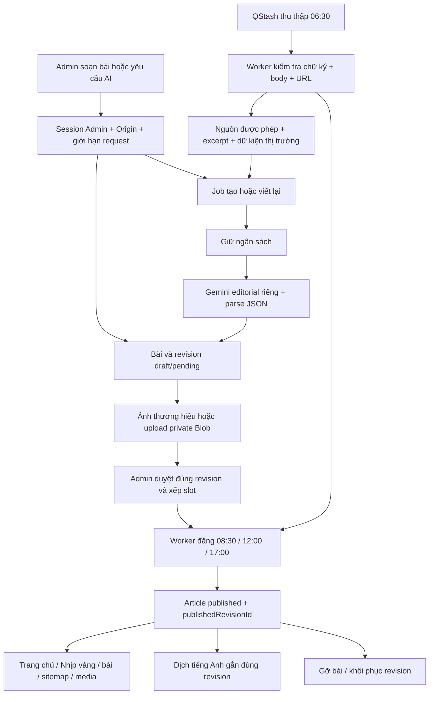

# Rà soát luồng đăng Tin vàng / Nhịp vàng

Ngày rà soát: **01/10/2026**, múi giờ Việt Nam. Đối tượng: working tree hiện tại của `chart-gold`, trên commit `e9737a287df403130acf1824a698bbde50e26303`, gồm các thay đổi chưa commit có sẵn.

## Kết quả chính

**Tái hiện 7 vấn đề chức năng/vận hành: 2 P1 và 5 P2.** Các vấn đề được kiểm chứng bằng hàm ứng dụng thật, với database và dịch vụ ngoài được mock. Có thêm một rủi ro cạnh tranh khi thu hồi duyệt và xuất bản, được mô phỏng interleaving; chưa kiểm chứng bằng PostgreSQL thật.

Quyền Admin, Origin, chữ ký QStash, chặn bản nháp công khai, protocol Markdown và escape JSON-LD/XML hoạt động trong những kịch bản đã kiểm tra. Chưa chứng minh được khai thác XSS, SQL injection hoặc SSRF trên production.

Đã chạy **30 kiểm thử có sẵn và 41 kịch bản audit**, tất cả đạt. Các kịch bản tái hiện lỗi cố ý kiểm tra hành vi lỗi hiện tại; kết quả xanh không có nghĩa các lỗi đã được sửa.

Chỉ bổ sung báo cáo và bằng chứng audit. Không sửa nguồn ứng dụng, API/schema, dữ liệu, lịch QStash hay cấu hình production; không deploy.

## Luồng hiện tại

Luồng thủ công cũng tạo bản nháp và cần duyệt/xếp lịch. Gemini sử dụng credential editorial riêng; không chuyển sang key chatbot. Nhánh ảnh hiện dùng thư viện thương hiệu hoặc upload, không gọi model tạo ảnh. Thu thập và dịch có khóa/lease; generation chưa có cơ chế tương đương. Reconcile chạy mỗi 10 phút để kiểm tra nguồn, slot và job chờ.

Các điểm vào chính là `/admin/bai-viet`, `/api/admin/articles`, `/api/admin/articles/[id]`, `/api/admin/articles/[id]/cover` và `/api/editorial/worker`. Cron Vercel cũ chỉ trả trạng thái disabled sau kiểm tra bearer secret.

## Các lỗi đã tái hiện

### F01 — P1: Job trùng tạo nhiều bản nháp nhưng chỉ ghi một khoản ngân sách

**Điều kiện:** cùng job generation được giao đồng thời, job đang `running` được giao lại, hoặc lỗi lưu trạng thái xảy ra sau khi đã tạo nháp.

[runEditorialGenerationJob](/D:/KinhDoanh/chart-gold/lib/editorial/workflow.ts:504) chỉ chặn job `completed`, sai stage và hết attempts. Hàm đọc rồi cập nhật theo ID, không claim có điều kiện và không khóa theo job; cũng không kiểm tra `retryAt`. [reserveEditorialCost](/D:/KinhDoanh/chart-gold/lib/editorial/budget.ts:167) trả `accepted: true` cho reservation key đã tồn tại.

Harness giao đồng thời một job: **2 lượt gọi Gemini, 2 lần tạo nháp, 1 ledger reservation, attemptCount cuối là 1**. Job `running` và job có `retryAt` ở ngày sau vẫn chạy. Khi inject lỗi ở completion update sau tạo nháp, job chuyển về queued; retry tạo thêm nháp, khoản giữ chi phí đầu bị release. Đây là lỗi persistence có kiểm soát, không phải thử kill process thật.

**Tác động:** tạo nội dung trùng, sử dụng AI vượt số lần phản ánh trong ngân sách, bỏ qua cooldown và gây trạng thái job khó đối soát. Số tiền nhà cung cấp thực thu chưa được đo.

**Hướng xử lý:** claim/lease theo job, kiểm tra stage/status/cooldown trong claim; lưu liên kết đầu ra theo job một cách idempotent, phục hồi đầu ra đã tạo trước retry; mỗi lần thực sự gọi provider có attempt và reservation riêng. Kiểm thử đồng thời, giao lại, lỗi sau tạo nháp và phục hồi job chạy quá hạn bằng database riêng.

### F02 — P1: “Gỡ bài” vẫn để lịch đăng kích hoạt lại bài

[unpublishArticle](/D:/KinhDoanh/chart-gold/lib/editorial/admin.ts:796) chỉ archive article và xóa `publishedRevisionId`; không hủy slot hay approval. [publishDueSlot](/D:/KinhDoanh/chart-gold/lib/editorial/admin.ts:715) kiểm tra approval nhưng không chặn article archived.

Harness giữ một revision đã duyệt/xếp lịch, gọi gỡ bài rồi đến giờ publish: article chuyển **archived → published** mà không có lần duyệt mới. Trường hợp thực tế là bài đang công khai có revision mới đã được xếp slot trong tương lai.

**Tác động:** quyết định gỡ bài có thể bị đảo ngược bởi lịch còn hiệu lực. Gỡ bài không bảo đảm bài tiếp tục ẩn.

**Hướng xử lý:** xác định thao tác gỡ toàn bài trong API/UI; hủy các slot chưa đăng và thu hồi approval liên quan trong cùng transaction, phối hợp khóa với publish. Nếu cần giữ lịch, cung cấp thao tác có tên rõ ràng riêng. Kiểm thử cả gỡ trước giờ đăng và cạnh tranh với worker.

### F03 — P2: Ảnh upload hỏng sau sửa/khôi phục và đăng revision mới

Upload lưu URL [gắn revision ban đầu](/D:/KinhDoanh/chart-gold/app/api/admin/articles/[id]/cover/route.ts:139). [Tạo revision mới](/D:/KinhDoanh/chart-gold/lib/editorial/admin.ts:321) và [khôi phục](/D:/KinhDoanh/chart-gold/lib/editorial/admin.ts:837) sao chép URL/storage key cũ. Media [chỉ cho khách đọc revision đang published](/D:/KinhDoanh/chart-gold/app/api/editorial/media/[revisionId]/route.ts:27).

Harness upload một ảnh WebP thật qua Sharp, đăng, sửa hoặc khôi phục, duyệt và đăng revision mới. URL ảnh trong bài vẫn trỏ revision cũ và guest GET trả **403 trong harness**; URL media theo ID revision mới trả 200. Trong ứng dụng, mã từ chối là 401/403 tùy session.

**Tác động:** ảnh bìa và ảnh chia sẻ của revision mới thất bại với yêu cầu mới. Cache đã nóng có thể che lỗi; chưa tái hiện trên image optimizer thật.

**Hướng xử lý:** khi dùng lại storage key, gắn URL media với revision mới hoặc tài nguyên media có quyền đọc dựa trên revision công khai tham chiếu. Kiểm thử upload → đăng → sửa/khôi phục → đăng lại → guest GET và ảnh OG/optimizer chưa cache. Ảnh thương hiệu không chịu lỗi này.

### F04 — P2: Bài chỉ có evidence bị thu hồi duyệt sau 50 phút

[Điều kiện xuất bản](/D:/KinhDoanh/chart-gold/lib/editorial/admin.ts:382) chấp nhận nguồn **hoặc** evidence. Nhưng [sourcesRemainReachable](/D:/KinhDoanh/chart-gold/lib/editorial/workflow.ts:940) trả false cho `sources=[]`; [recheckScheduledSources](/D:/KinhDoanh/chart-gold/lib/editorial/workflow.ts:963) thu hồi duyệt của slot đã hơn 50 phút.

Cùng một nội dung evidence-only: duyệt 07:00, reconcile 08:00 khiến approval thành revoked và slot failed, không gọi mạng. Duyệt 08:00 và đăng 08:31 lại thành công.

**Tác động:** tính hợp lệ của bài phụ thuộc thời gian từ lúc duyệt; dữ kiện nội bộ hợp lệ có thể không đăng theo lịch.

**Hướng xử lý:** thống nhất publish validator và recheck. Evidence-only cần cách kiểm tra riêng; nguồn không có URL để HEAD không được coi mặc định là lỗi. Phân biệt lỗi mạng tạm thời với thu hồi nguồn thực sự. Kiểm thử trước/sau mốc 50 phút và HEAD 405/429/timeout.

### F05 — P2: Timeout sau khi gọi Gemini bị ghi như chưa dùng provider

[generateEditorialDraft](/D:/KinhDoanh/chart-gold/lib/editorial/generation.ts:368) kiểm tra signal aborted và throw trước khi ghi attempt đang thất bại. Ở lần gọi đầu, error chứa `attempts=[]`. [Worker](/D:/KinhDoanh/chart-gold/lib/editorial/workflow.ts:625) coi mảng này là không retryable, rồi [release reservation](/D:/KinhDoanh/chart-gold/lib/editorial/workflow.ts:655) vì không có attempt upstream.

Harness abort signal sau SDK dispatch: **đã gọi Gemini 1 lần, job failed, retryAt null, không có attempt row, reservation released**.

**Tác động:** timeout tạm thời làm mất nháp và retry, thiếu thông tin đối soát và có thể thiếu chi phí. Không thể kết luận upstream đã tính tiền từ mock.

**Hướng xử lý:** ghi attempt ngay khi dispatch và giữ dấu “đã liên hệ provider”; phân loại timeout ở đúng tầng, bảo toàn chi phí chưa biết thay vì mặc định release. Rà cùng mẫu abort trong translation. Kiểm thử abort trước dispatch, sau dispatch, timeout nội bộ và response không có usage.

### F06 — P2: Retry ghi lại attempt số 1 và mất bản ghi thành công

[recordGenerationAttempts](/D:/KinhDoanh/chart-gold/lib/editorial/workflow.ts:481) bắt đầu `attemptNumber=index+1` ở mỗi lần worker chạy, rồi bỏ qua conflict. [Schema](/D:/KinhDoanh/chart-gold/db/schema.ts:721) có unique `(jobId, attemptNumber)`.

Harness xác nhận index từ schema thật và mô phỏng uniqueness: lần đầu 429 ghi attempt 1 failed; retry thành công lại insert attempt 1, bị loại. Job completed nhưng bản ghi attempts còn lại vẫn báo failed.

**Tác động:** lịch sử provider, số lần thử, usage và chẩn đoán lỗi không phản ánh kết quả cuối. Đây là mô phỏng thao tác SQL theo constraint, không chạy INSERT trên PostgreSQL thật.

**Hướng xử lý:** số attempt tăng toàn cục theo job hoặc dùng khóa occurrence duy nhất, cấp số trong claim/transaction. Kiểm thử 429 → thành công, nhiều lần retry và nhiều chunk dịch; không dùng conflict suppression để che lỗi định danh attempt.

### F07 — P2: Ngày evidence không hợp lệ làm trang bài đã đăng throw

[validateEvidence](/D:/KinhDoanh/chart-gold/lib/editorial/admin.ts:113) chỉ cắt chiều dài `observedAt` khi là string. Publish validator không xác minh ngày. [Trang bài viết](/D:/KinhDoanh/chart-gold/app/nhip-vang/[slug]/page.tsx:197) đưa giá trị này vào `Intl.DateTimeFormat.format(new Date(value))`.

Harness dùng `observedAt='bad-date'`: đầu vào vẫn được chấp nhận, approval/publication thành công, gọi trang bài thật ném **RangeError: Invalid time value**.

**Tác động:** một trường metadata làm hỏng trang bài công khai. Ngày này hiện đến từ dữ liệu admin/evidence, không phải một quyền ghi công khai của khách.

**Hướng xử lý:** validate và normalize timestamp khi nhập; render có fallback khi gặp dữ liệu cũ hỏng. Kiểm thử ngày sai, ngày thiếu, timezone hợp lệ và bản ghi lịch sử đã tồn tại.

## Rủi ro và giới hạn cần kiểm chứng tiếp

### R01 — Ưu tiên P1: Thu hồi duyệt có thể cạnh tranh với publish

Approval dùng khóa theo ngày ở [admin.ts](/D:/KinhDoanh/chart-gold/lib/editorial/admin.ts:508); publish dùng khóa theo slot ở [admin.ts](/D:/KinhDoanh/chart-gold/lib/editorial/admin.ts:679). Request changes, skip và recheck nguồn không phối hợp cùng khóa; các write publish sau khi đọc approval chủ yếu lọc theo ID.

Harness tạo interleaving: publish đọc approved → request changes commit, đổi thành changes_requested và mở slot → publish tiếp tục vẫn đăng revision. **Đây là một lịch thực thi trên DB mock, chưa xác nhận race ở PostgreSQL.** Cần chạy hai connection ở isolation thật, kiểm tra cả skip/revoke/đổi ảnh/approval đồng thời trước khi khẳng định mức ảnh hưởng production. Hướng xử lý là khóa hàng hoặc khóa chung và điều kiện chuyển trạng thái có kiểm tra lại.

### R02 — Ưu tiên P2: Redirect vượt ranh giới host nguồn

[Scouting](/D:/KinhDoanh/chart-gold/lib/editorial/scouting.ts:249) kiểm tra URL đầu nhưng fetch mặc định follow redirect; recheck cũng [follow redirect](/D:/KinhDoanh/chart-gold/lib/editorial/workflow.ts:946). Harness trả Response mock có `redirected=true`, `response.url` ngoài allowlist: excerpt vẫn được dùng và gắn URL nguồn ban đầu. URL đầu ngoài allowlist bị chặn trước fetch.

Đã xác nhận thiếu kiểm tra URL đích cuối bằng response giả. **Chưa có endpoint allowlisted do attacker kiểm soát, redirect thật hay truy cập mạng nội bộ được chứng minh; chưa kết luận SSRF khai thác được.** Khuyến nghị kiểm tra từng redirect hop, protocol/port/credentials/địa chỉ đích và giới hạn bytes phản hồi trước khi lấy excerpt.

### R03 — Dữ liệu nguồn/AI vẫn là dữ liệu chưa tin cậy

Instruction-like excerpt đi nguyên văn vào user prompt; system instruction riêng vẫn tồn tại, không có model tools trong luồng đã xem. Harness chỉ kiểm tra cấu trúc prompt, không chứng minh Gemini tuân theo prompt injection. Parser JSON chủ yếu kiểm tra kiểu và chiều dài; người duyệt là ranh giới xác minh nội dung chính.

Markdown không chạy raw HTML và không cho link `javascript:`/`data:` trong kiểm thử, nhưng vẫn tải ảnh HTTPS và mở link HTTPS tùy ý. Vì vậy có thể xuất hiện link sai nguồn hoặc ảnh tracking nếu Admin duyệt nội dung đó. Đây là browser fetch, không tự động là SSRF server.

### R04 — Cache, crawler và dừng automation

- Media công khai trả [immutable một năm](/D:/KinhDoanh/chart-gold/app/api/editorial/media/[revisionId]/route.ts:48). Gỡ bài thay đổi quyền đọc DB nhưng không đảm bảo thu hồi bytes đã cache. Chưa kiểm tra cache CDN/optimizer đã nóng; cần xác định kỳ vọng giữ ảnh từng công khai và chiến lược cache phù hợp.
- Upload OG nằm dưới `/api/editorial/media/…`, trong khi [robots](/D:/KinhDoanh/chart-gold/app/robots.ts:6) disallow `/api/`. Metadata khai báo 1536×1024, upload thực tế normalize 1200×675. Đã xác nhận cấu hình, chưa xác nhận crawler thực tế bỏ ảnh.
- `EDITORIAL_AUTOMATION_ENABLED=false` không phải kill switch của worker. Test với SDK chữ ký thật và key giả dành riêng audit vẫn dispatch được message đã ký khi cờ false. Reconcile cũng xử lý publish trước phần kiểm tra cờ enqueue. Cần pause schedule và xử lý message tồn đọng nếu mục tiêu là dừng toàn bộ hoạt động.
- Reconcile hiện truy vấn job queued; chưa thấy nhánh phục hồi generation `running` quá hạn. Lỗi completion sau tạo nháp đã tái hiện ở F01; kill process/lease expiry chưa được thử.

## Những kiểm soát đã xác nhận

| Ranh giới | Bằng chứng |
| --- | --- |
| Session/quyền Admin | Guest 401, member 403, allowlisted email được normalize; kiểm tra ở API riêng |
| CSRF và payload | Thiếu/khác Origin bị chặn; POST/PATCH/DELETE từ guest bị từ chối; mutation sai trả 400 |
| Worker | SDK QStash thật chặn body/URL bị đổi, chữ ký hết hạn; chấp nhận key current/next giả dùng riêng audit; payload sai không dispatch |
| Nội dung công khai | Đọc status published và publishedRevisionId; revision mới pending không thay nội dung đang đăng; guest không đọc media nháp |
| Ảnh upload | Auth/Origin và article–revision; giới hạn raster upload; decode/re-encode bằng Sharp; Blob private; revision đã duyệt cần tạo bản mới để đổi ảnh |
| Markdown và metadata | Raw HTML/protocol nguy hiểm bị xử lý; JSON-LD escape `<`; sitemap escape XML với payload đối kháng |
| Ngôn ngữ | English ready gắn sourceRevisionId cụ thể; fallback tiếng Việt khi chưa có bản dịch phù hợp — đối chiếu mã nguồn và kiểm thử translation có sẵn |

Chưa gọi OAuth Google thật, QStash thật hay Gemini thật trong audit; các kết quả xác minh chữ ký dùng JWT tự ký bằng key audit và verifier SDK thật.

## GitNexus và kiểm thử

Tạo bản sao không chứa `.env`, secrets, `node_modules` hay artifact build; chạy `--pdg --index-only --skip-git`, sử dụng `GITNEXUS_HOME` riêng trong thư mục audit. Lần đăng ký vào registry mặc định bị sandbox từ chối ghi; chuyển sang registry riêng thành công, không cần thay đổi registry dùng chung.

Chỉ mục: **348 files, 19.414 nodes, 42.814 edges**. `explain` trên 8 điểm neo editorial trả **0 finding**; `context` xác nhận các hàm generation, publishing, revision và evidence. GitNexus không bao phủ đầy đủ callbacks/properties/async/guard sanitizers và không kiểm chứng idempotency, transaction, chi phí hay prompt integrity. Vì vậy kết quả rỗng không phủ định F01–F07.

| Bộ kiểm thử | Kết quả | Phương pháp |
| --- | --- | --- |
| Existing editorial + origin | 30/30 | `npm test -- editorial origin`, 7 files |
| Auth + chữ ký worker | 15/15 | API/guard thật, auth/database mock, verifier QStash SDK thật |
| Generation + ingestion | 12/12 | Workflow/generation/budget/scouting và schema thật, SDK/fetch/database mock |
| Publication | 4/4 | Approval/publish/unpublish/reconcile thật, DB mock và clock cố định |
| Rendering | 10/10 | Upload/revision/publish/page/Markdown/sitemap thật, Sharp thật, I/O mock |

Không chạy E2E có ghi dữ liệu trên production. Chưa dùng database E2E riêng để xác minh isolation/SQL; chưa thử cache nóng, crawler thật, crash process hoặc chi phí provider thực. Bộ test cũ tập trung primitives/provider/UI và chưa bao phủ các tình huống vận hành đã tái hiện. Việc lint/build/deploy không áp dụng vì không có chỉnh sửa nguồn ứng dụng.

## Kiểm tra production chỉ đọc

Thời điểm: **15:28 ngày 01/10/2026**. Node fetch không cookie, chỉ GET, không gọi action quản trị hoặc POST worker.

| URL/hành vi | Kết quả |
| --- | --- |
| [Nhịp vàng](https://www.vanghomnay.online/nhip-vang) và [phương pháp biên tập](https://www.vanghomnay.online/bien-tap) | 200, có nội dung/title |
| Hai bài được chọn từ hub | 200, nội dung công khai tải được |
| GET `/api/admin/articles`, `/api/cron/editorial` từ khách | 401 |
| GET `/api/editorial/worker` | 405 |
| robots, sitemap, news sitemap | 200; robots disallow `/api/`; news sitemap rỗng tại thời điểm đọc, chưa kết luận lỗi |
| Slug không tồn tại | 200, thông báo không tìm thấy + noindex; đây là soft-404 cần cân nhắc SEO, không phải bằng chứng lọt bản nháp |

Không biết deployment SHA từ các GET này. Các lỗi F01–F07 được xác nhận ở working tree local, không khẳng định đã xảy ra trên bản production hiện tại. Không đăng bài thử hoặc gây lỗi trên production để chứng minh.

## Bằng chứng và thứ tự xử lý đề xuất

Bằng chứng máy đọc ở [outputs/editorial-audit-20261001](/D:/KinhDoanh/chart-gold/outputs/editorial-audit-20261001): kết quả JSON từng nhóm, production GET, GitNexus, trạng thái Git trước audit và SHA-256 của các file được rà soát. [Gói harness](/D:/KinhDoanh/chart-gold/outputs/editorial-audit-20261001/harness.zip) chứa mã kiểm thử và README; giải nén vào `work/editorial-audit-20261001` từ repo để chạy lại. Harness tạm được dọn sau đóng gói để không bị `tsconfig` của ứng dụng quét vào build.

Ưu tiên giải quyết F01 và F02 cùng xác minh R01 trước khi tăng automation; sau đó sửa vòng đời ảnh, recheck evidence, timeout/accounting, attempt identity và ngày dữ kiện. Mỗi thay đổi nguồn ở đợt sửa tiếp theo phải chạy kiểm thử phù hợp, deploy project Vercel `chart-gold` theo AGENTS.md và xác minh hành vi trên `www.vanghomnay.online`.
